# Waypoint: a LangGraph RAG question line

Ask questions about your own documents and **watch the LangGraph workflow run, station by station**. Each question rides a train down a transit-map version of the graph (`START → retrieve → generate → END`) while the shared state fills in live.

<p align="center">
  
  
  
  
  
</p>

<p align="center">
  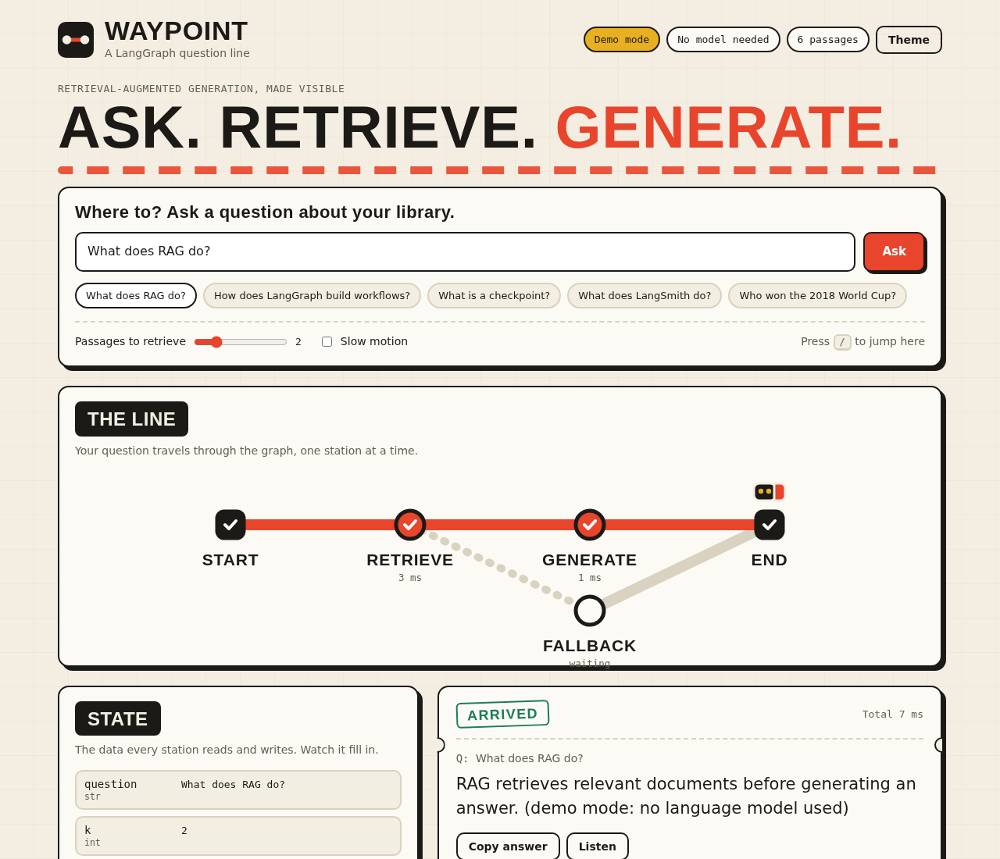
</p>

---

## 📑 Table of Contents

1. [✨ Features](#-features)
2. [🧠 How It Works](#-how-it-works)
3. [📁 Project Structure](#-project-structure)
4. [🚀 Quick Start](#-quick-start)
5. [🖼️ Screenshots](#️-screenshots)
6. [🖥️ Using the App](#️-using-the-app)
7. [🔌 API Reference](#-api-reference)
8. [🎛️ Configuration](#️-configuration)
9. [🧪 Tests](#-tests)
10. [🛠️ Troubleshooting](#️-troubleshooting)
11. [🌱 Ideas to Extend](#-ideas-to-extend)
12. [📚 Learning Material](#-learning-material)
13. [🧰 Tech Stack](#-tech-stack)

---

## ✨ Features

- **Conditional routing**: weak matches take a `fallback` branch, and the map shows which route the train took
- **Live workflow map**: the LangGraph graph is drawn as a transit line; a train moves to each station as the node runs, with per-node timing
- **State inspector**: see `question`, `k`, `sources`, `context`, and `answer` fill in as each node finishes
- **Grounded answers**: the model answers only from retrieved passages and says it doesn't know otherwise
- **Citations**: the model cites passages as [1], [2]; click a number to jump to and highlight that source
- **PDF upload**: load a text-based PDF (or `.txt` / `.md`) into the library and ask about it
- **Sources with match scores**: see exactly which passages were retrieved and how closely each matched
- **Journey log**: every question is saved in your browser; click one to bring back its answer, sources, and state
- **Listen and export**: hear the answer read aloud, or export the journey log as Markdown
- **Controls**: choose how many passages to retrieve (1 to 6), turn on slow motion to teach the flow, copy the answer, press `/` to jump to the question box
- **Keyword highlights** in the retrieved sources, and a "Retrieved #n" badge on the matching library cards
- **Five themes** (Paper, Night, Blueprint, Terminal, Neon), picked with the swatches in the header and remembered between visits
- **Station chimes** (optional sound), **Helpful / Not helpful** feedback saved in the log, and a **library search box**
- **Editable library**: paste text or load a `.txt` / `.md` file, add it, and ask about it immediately; long text is split into passages
- **Streaming API**: the backend streams each node's result as newline-delimited JSON
- **Bring your own key**: use a server-side `GROQ_API_KEY`, or type a key into the app (kept in your browser)
- **Demo mode**: runs with no API key and no model download, handy for trying the UI or testing
- **Responsive and accessible**: the map turns vertical on phones; keyboard focus, screen-reader labels, and reduced-motion support included
- **Tests and CI**: pytest suite plus a GitHub Actions workflow

---

## 🧠 How It Works

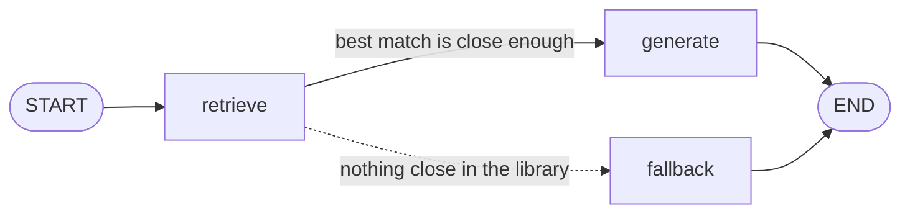

| Step | Node | What it does |
| --- | --- | --- |
| 1 | `retrieve` | Embeds the question, finds the top-`k` most similar passages in the library, and writes `sources` and `context` into the state |
| 2 | `generate` | Sends the context and question to the Groq model with a prompt that restricts it to that context, and writes `answer` |
| 2b | `fallback` | Used instead of `generate` when the best match scores below `MIN_SCORE`. It makes no model call and asks the user to rephrase or add a passage |

The choice between `generate` and `fallback` is a **conditional edge** (`add_conditional_edges`). On the map, the dotted line is the branch that was not taken.

**Shared state**

```python
class State(TypedDict):
    question: str
    k: int
    sources: list[dict]
    context: str
    answer: str
```

The browser calls `POST /api/ask/stream`. The backend runs the compiled graph with `stream_mode="updates"` and sends one event per node, which the frontend turns into train movement and state updates.

```
Browser  ──POST /api/ask/stream──▶  FastAPI  ──graph.stream()──▶  retrieve ─▶ generate
   ▲                                   │                              │          │
   └──── start · node_start · node_end · done (NDJSON) ◀──────────────┴──────────┘
```

---

## 📁 Project Structure

```
waypoint-langgraph-rag/
├── backend/
│   ├── app/
│   │   ├── main.py            # FastAPI routes, streaming, static frontend
│   │   ├── graph.py           # LangGraph workflow (State, nodes, edges)
│   │   ├── library.py         # Vector store, passage registry, chunking, PDF text
│   │   ├── engine.py          # Wires settings, embeddings, LLM, graph
│   │   ├── demo.py            # Keyword embeddings + extractive answerer
│   │   ├── config.py          # Environment settings
│   │   └── schemas.py         # Request models
│   ├── tests/                 # pytest suite
│   ├── requirements.txt       # Full install (Groq + sentence-transformers)
│   ├── requirements-demo.txt  # Light install for demo mode
│   ├── requirements-dev.txt   # Demo deps + pytest
│   └── .env.example
├── frontend/
│   ├── index.html
│   ├── css/styles.css
│   └── js/
│       ├── config.js          # API base URL (edit when hosting separately)
│       ├── api.js             # Fetch + NDJSON stream reader
│       ├── map.js             # Transit-map SVG and train animation
│       └── main.js            # UI logic
├── data/sample_docs.json      # Starter library
├── examples/langgraph_practice.py   # The original class script (CLI)
├── docs/
│   ├── architecture.md        # Event protocol and design notes
│   ├── screenshots/
│   ├── Waypoint_Presentation.pptx   # Project slide deck
│   ├── Waypoint_Report.docx         # Project report
│   └── LangChain_LangGraph_LangSmith_Basics.pptx
├── .github/workflows/tests.yml
└── README.md
```

---

## 🚀 Quick Start

You need **Python 3.10+**. The first real-mode run downloads the embedding model from Hugging Face, so it needs internet.

### 1. Clone and enter the backend

```bash
git clone https://github.com/scientistayat-engineer/waypoint-langgraph-rag.git
cd waypoint-langgraph-rag/backend
```

### 2. Create a virtual environment

Windows (PowerShell):

```powershell
py -m venv .venv
.venv\Scripts\Activate.ps1
```

Linux / macOS:

```bash
python3 -m venv .venv
source .venv/bin/activate
```

### 3a. Real mode (Groq + local embeddings)

```bash
pip install -r requirements.txt
```

Copy `.env.example` to `.env` and add your [Groq API key](https://console.groq.com/keys):

```bash
cp .env.example .env        # Windows: copy .env.example .env
```

```
GROQ_API_KEY=your-key-here
```

Or skip the file and paste the key into the app later.

### 3b. Demo mode (no key, no model download)

```bash
pip install -r requirements-demo.txt
```

Windows (PowerShell): `$env:DEMO_MODE = "true"`  
Linux / macOS: `export DEMO_MODE=true`

### 4. Start the server

```bash
uvicorn app.main:app --reload
```

Open **http://127.0.0.1:8000**. FastAPI serves the frontend and the API from the same address.

---

## 🖼️ Screenshots

A walkthrough of one session, so you can follow the whole app from the pictures alone. (Taken in demo mode, so answers are extracted sentences rather than model-written text.)

**1. Ask a question.** Type a question or click an example. Choose how many passages to retrieve, and turn on slow motion or station chimes.

<p align="center">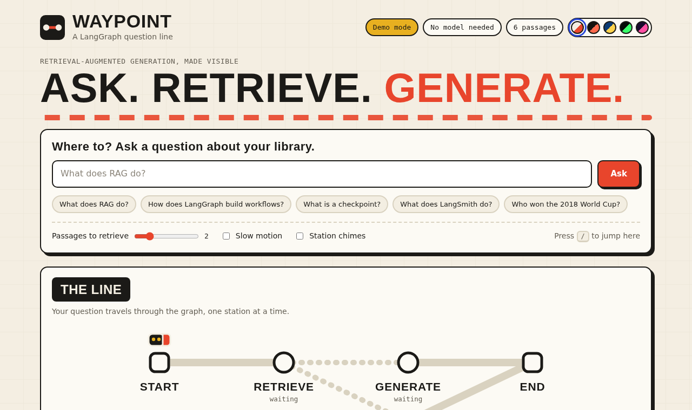</p>

**2. Watch the line.** The train stops at each station; finished stations show their timing, and the state fills in as nodes finish.

<p align="center">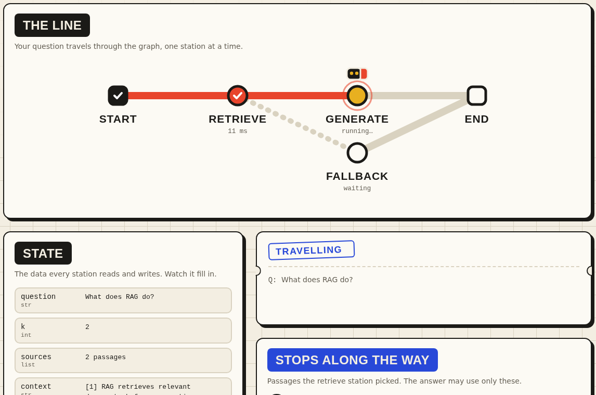</p>

**3. Read the answer.** The answer ticket, the state panel, and the retrieved sources with match scores.

<p align="center">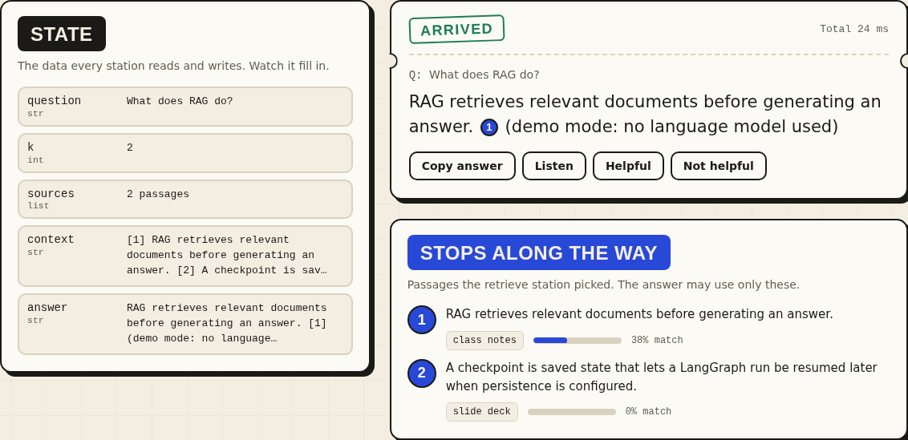</p>

**4. Check the citations.** Clicking a citation number scrolls to and highlights its source.

<p align="center">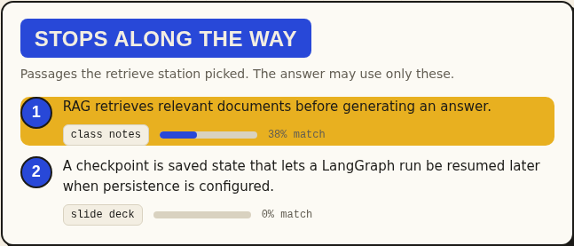</p>

**5. See the fallback route.** An unrelated question is rerouted: no model call, and the stamp reads "Rerouted".

<p align="center">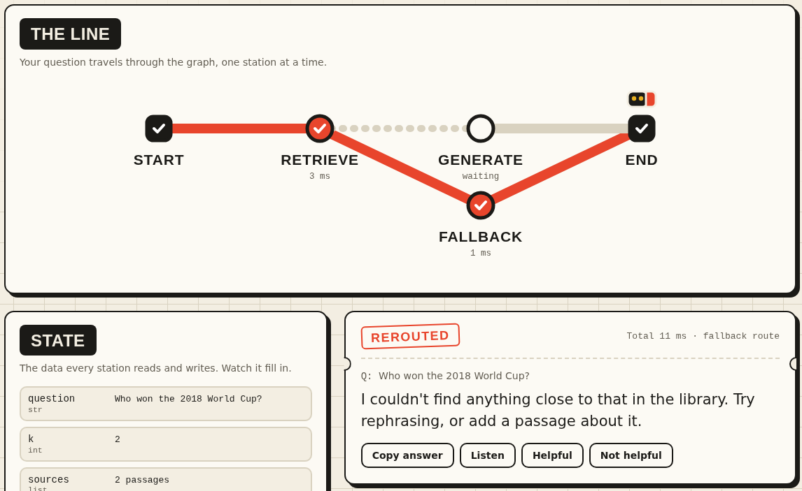</p>

**6. Manage the library.** Paste text or upload a PDF; retrieved passages are badged with their rank.

<p align="center">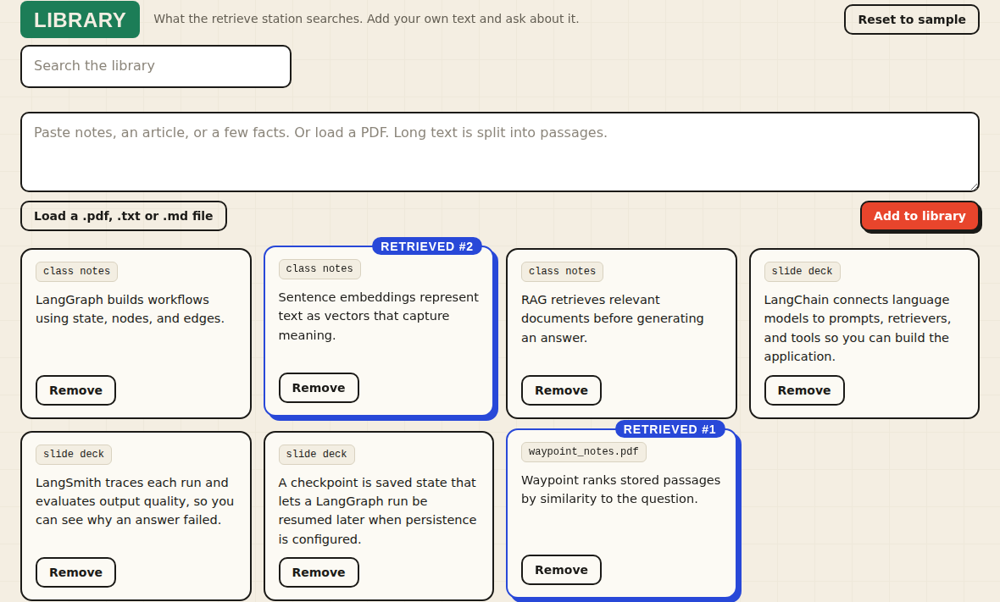</p>

**7. Revisit past questions.** The journey log keeps answers and feedback and can be exported as Markdown.

<p align="center">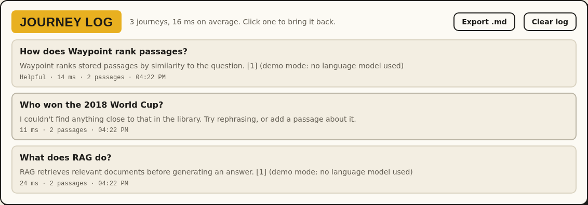</p>

**8. Pick a theme.** Paper, Night, Blueprint, Terminal, and Neon.

<p align="center">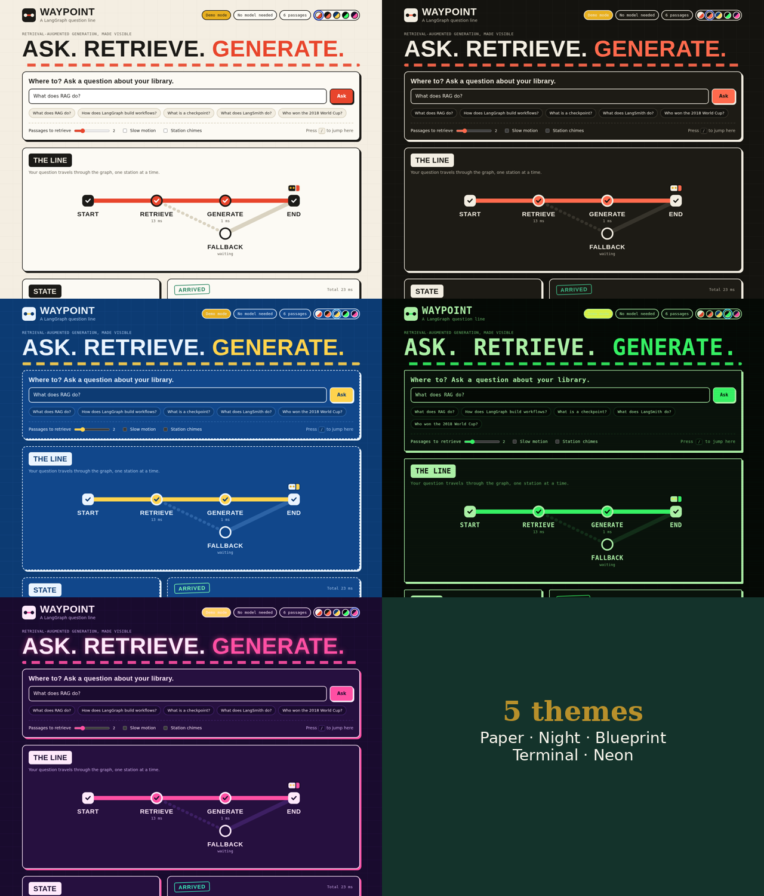</p>

**9. Use it on a phone.** The layout becomes one column and the map turns vertical.

<p align="center">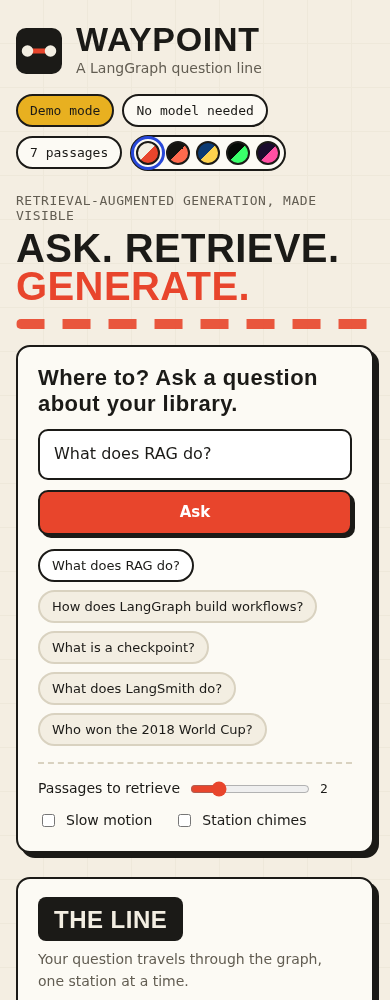</p>

---

## 🖥️ Using the App

1. **Ask**: type a question or click an example chip. The last chip is a trick question that is not in the library, so you can see the fallback route.
2. **Watch the line**: the train stops at `retrieve`, then `generate`. Each station shows how long it took.
3. **Read the state**: rows light up as `sources`, `context`, and `answer` are written.
4. **Check the sources**: "Stops along the way" lists the retrieved passages with match scores.
5. **Tune it**: use the slider to retrieve more or fewer passages, or tick **Slow motion** to give each station more time.
6. **Revisit**: the **Journey log** at the bottom keeps your past questions; click one to restore it.
7. **Grow the library**: paste text or load a `.txt` / `.md` file, click **Add to library**, and ask about it. Use **Reset to sample** to go back to the starter documents.

If the server has no key, the app asks for one in a dialog the first time you ask. The key is stored in your browser's local storage and sent in an `X-Groq-Key` header; the server does not save it.

---

## 🔌 API Reference

| Method | Path | Purpose |
| --- | --- | --- |
| `GET` | `/api/health` | Mode, model names, passage count |
| `GET` | `/api/graph` | Nodes and edges of the compiled graph |
| `GET` | `/api/documents` | List passages |
| `POST` | `/api/documents/upload` | Upload a `.pdf`, `.txt`, or `.md` file (multipart field `file`, up to 5 MB) |
| `POST` | `/api/documents` | Add text (`{"text": "...", "source": "pasted"}`), split into passages |
| `DELETE` | `/api/documents/{id}` | Remove one passage |
| `POST` | `/api/documents/reset` | Restore the sample library |
| `POST` | `/api/ask` | Ask and get one JSON response |
| `POST` | `/api/ask/stream` | Ask and stream node-by-node events (NDJSON) |

Interactive docs are at `/docs` while the server runs. Event formats and error codes are in [`docs/architecture.md`](docs/architecture.md).

```bash
curl -X POST http://127.0.0.1:8000/api/ask \
  -H "Content-Type: application/json" \
  -H "X-Groq-Key: your-key-here" \
  -d '{"question": "What does RAG do?"}'
```

---

## 🎛️ Configuration

Set these as environment variables or in `backend/.env`.

| Variable | Default | Purpose |
| --- | --- | --- |
| `GROQ_API_KEY` | empty | Server-side key. If empty, users supply their own in the app |
| `GROQ_MODEL` | `openai/gpt-oss-120b` | Groq chat model |
| `EMBEDDING_MODEL` | `sentence-transformers/all-MiniLM-L6-v2` | Local embedding model |
| `TOP_K` | `2` | Passages retrieved per question (1 to 10) |
| `MIN_SCORE` | `0.15` | Best-match score below which a question is rerouted to `fallback`. Tune it for your embedding model |
| `LANGSMITH_TRACING`, `LANGSMITH_API_KEY` | unset | Set these (see `.env.example`) to trace every run in LangSmith. No code change needed |
| `EMBEDDING_BACKEND` | `huggingface` | `keyword` swaps the MiniLM model for lightweight keyword search (no PyTorch needed) |
| `DEMO_MODE` | `false` | Keyword search and an extractive answerer, no key or download |
| `CORS_ORIGINS` | `*` | Comma-separated origins allowed to call the API |
| `FRONTEND_DIR` | `../frontend` | Folder FastAPI serves at `/` |
| `SEED_FILE` | `data/sample_docs.json` | Starter library |

Limits: questions 2 to 500 characters, up to 60 passages of at most 800 characters each, uploads up to 20,000 characters of text (files up to 5 MB). Scanned PDFs without selectable text are rejected.

---

## 🧪 Tests

```bash
cd backend
pip install -r requirements-dev.txt
python -m pytest -q
```

The suite uses demo mode, so it needs no key or network. It covers the graph structure and branching, retrieval ranking, grounded and "I don't know" answers, chunking, document CRUD, the streaming event order, and API key handling. GitHub Actions runs the same tests on every push.

---

## 🛠️ Troubleshooting

| Problem | Fix |
| --- | --- |
| Page says the server is offline | Start the backend (`uvicorn app.main:app --reload` inside `backend/`) and reload |
| "Add your Groq API key" | Add `GROQ_API_KEY` to `backend/.env`, or use the **API key** button in the app |
| "Groq rejected the API key" | Check the key for typos or extra spaces |
| Model not found | Groq model names change. Pick a current one in the Groq Console and set `GROQ_MODEL` |
| First start is slow | The embedding model is being downloaded; later starts are faster |
| `ModuleNotFoundError` | Activate the virtual environment and reinstall requirements |
| PowerShell blocks `Activate.ps1` | Run `Set-ExecutionPolicy -Scope CurrentUser RemoteSigned` once |
| Library resets | It lives in memory, so it resets when the server restarts |

---

## 🌱 Ideas to Extend

- Add **conversation memory** with a LangGraph checkpointer so follow-up questions work
- Use a **persistent vector store** such as ChromaDB or FAISS, so the library survives restarts
- Read **scanned PDFs** with OCR (only PDFs with selectable text work today)
- Add a **compare mode** that shows two settings or models side by side
- Stream the answer **token by token**
- Add **checkpoints** so a run can be saved and resumed
- Show **token-by-token** answers by streaming the model output
- Add **user accounts** and a per-user library

---

## 📚 Learning Material

- [`docs/Waypoint_Presentation.pptx`](docs/Waypoint_Presentation.pptx) and [`docs/Waypoint_Report.docx`](docs/Waypoint_Report.docx): the project slide deck and written report
- [`docs/LangChain_LangGraph_LangSmith_Basics.pptx`](docs/LangChain_LangGraph_LangSmith_Basics.pptx): beginner slide deck on the three tools and this project
- [`examples/langgraph_practice.py`](examples/langgraph_practice.py): the original single-file class script this app grew from

---

## 🧰 Tech Stack

- [LangGraph](https://github.com/langchain-ai/langgraph) and [LangChain](https://github.com/langchain-ai/langchain) for the workflow
- [Groq](https://groq.com/) for LLM inference
- [Sentence Transformers](https://www.sbert.net/) for embeddings
- [FastAPI](https://fastapi.tiangolo.com/) and [Uvicorn](https://www.uvicorn.org/) for the backend
- Vanilla HTML, CSS, and JavaScript (ES modules) for the frontend, with no build step

---

## 🙏 Acknowledgements

Built as a class project at SMIT (AI and Data Science) on LangGraph and RAG, extended into a full-stack app.
